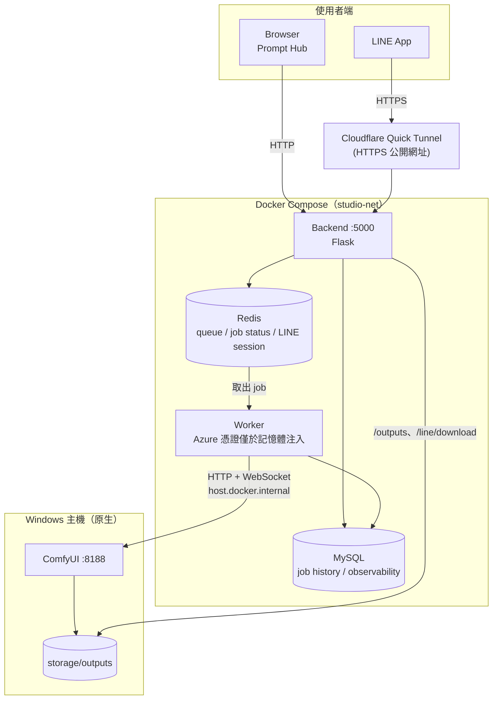
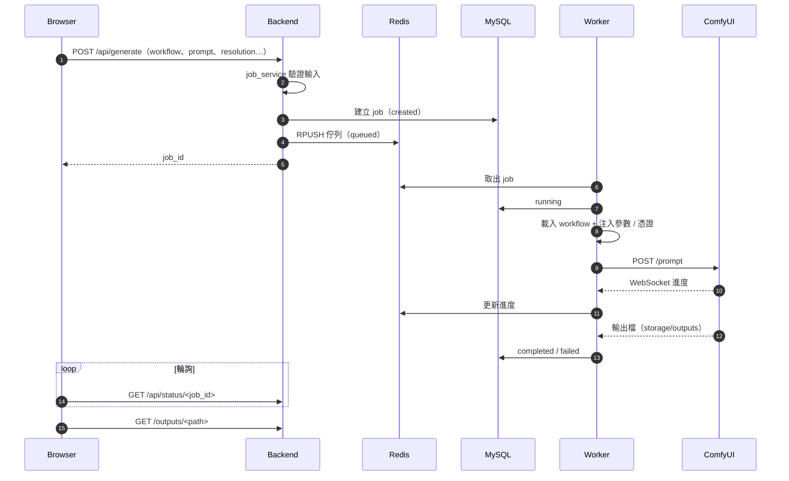
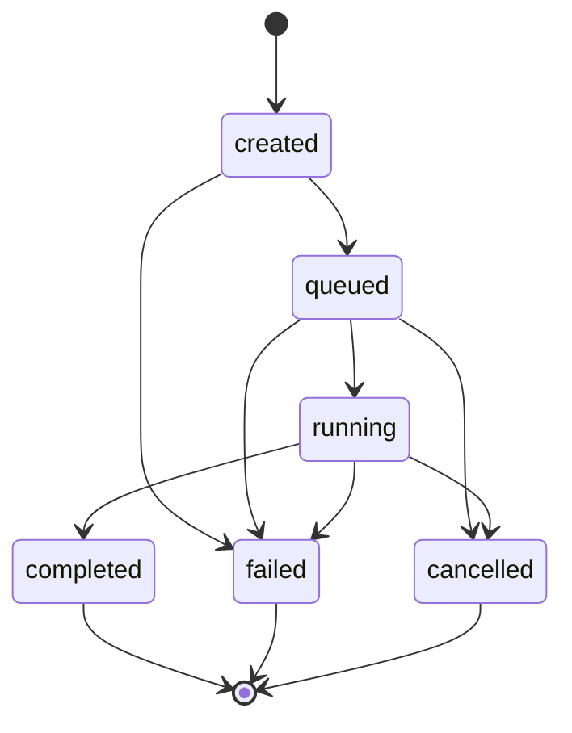
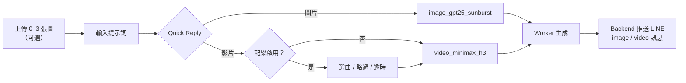
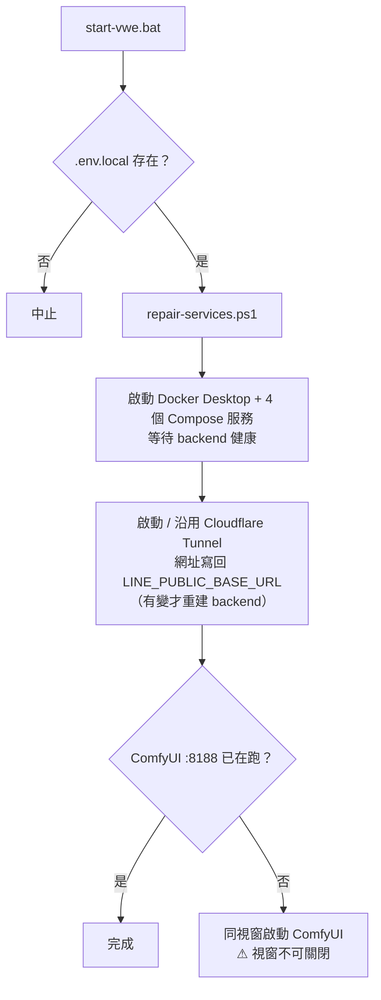
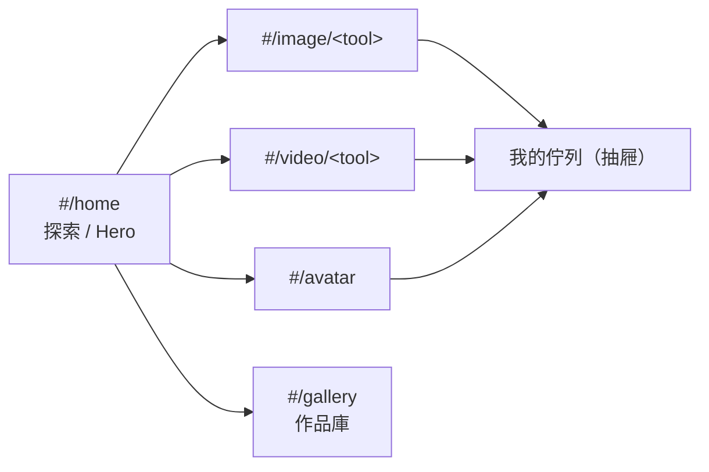
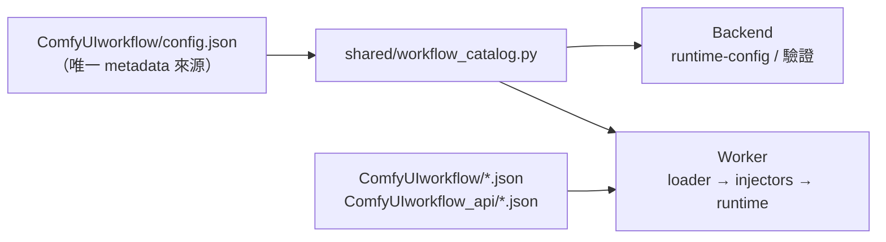

# ComfyUI Studio

以 **Flask + Redis + MySQL + Python Worker + 本機 ComfyUI** 組成的影像／影片生成服務，提供兩個入口：

| 入口 | 說明 |
| --- | --- |
| 網頁 Prompt Hub | `http://localhost:5000/`，免登入，以 tempcode cookie 區分使用者 |
| LINE Bot | 經 Cloudflare Quick Tunnel 對外，Webhook `/line/webhook` |

---

## 1. 系統架構



| 元件 | 執行位置 | 職責 | 主要程式 |
| --- | --- | --- | --- |
| Backend | Docker（`studio-backend`） | API、前端靜態檔、LINE adapter、輸入驗證與排入 job | `backend/src/` |
| Worker | Docker（`studio-worker`） | 取出 job、注入參數、送 ComfyUI、收集輸出、更新狀態 | `worker/src/` |
| Redis | Docker（`studio-redis`） | job 佇列、job 狀態、LINE 對話 session | — |
| MySQL | Docker（`studio-mysql`） | job 歷史、dispatch、observability（作品庫來源） | `migrations/` |
| ComfyUI | Windows 原生 | 實際執行 workflow 推論 | 不在 Compose 內 |
| Shared | Backend／Worker 共用 | 設定、workflow catalog、job contract、路徑安全 | `shared/` |

- Compose 四個服務皆 `restart: always`；Backend 與 Worker 等 MySQL healthcheck 通過才啟動。
- Backend healthcheck 要求 `/health` 回 200 且 `status == "ok"`。
- 唯一設定契約：`docker-compose.yml` + `.env.local`。

---

## 2. 任務流程

### 2.1 生成請求（網頁）



### 2.2 Job 狀態機



| 內部狀態 | 對外 API 狀態 | 說明 |
| --- | --- | --- |
| `created` | `queued` | 已寫入 DB，尚未進佇列 |
| `queued` | `queued` | 已在 Redis 佇列等待 |
| `running` | `processing` | Worker 執行中 |
| `completed` | `finished` | 完成，有輸出檔 |
| `failed` | `failed` | 失敗（含錯誤碼） |
| `cancelled` | `cancelled` | 使用者取消；以 `prompt_id` 精準中斷 ComfyUI |

### 2.3 LINE Bot 對話流程



| 選擇 | 圖片數 | Workflow | 模式 |
| --- | --- | --- | --- |
| 圖片 | 0–3 | `image_gpt25_sunburst` | 文生圖／參考圖 |
| 影片 | 0 | `video_minimax_h3` | T2V |
| 影片 | 1 | `video_minimax_h3` | I2V（首幀） |
| 影片 | 2 | `video_minimax_h3` | FL2V（首尾幀） |

| 規則 | 說明 |
| --- | --- |
| 取消 | 輸入「取消」清除已上傳圖片與提示詞 |
| 比例關鍵字 | `9:20`／`手機比例`（576×1280）、`9:16`／`直式`（864×1536）、`16:9`／`橫式`（1536×864）、`1:1`（1024×1024） |
| 未指定比例 | 有參考圖時沿用第一張圖比例（含 EXIF 旋轉），否則用 catalog `defaults` |
| 媒體連結 | `/line/download/<token>`、`/line/preview/<token>`，token 預設 7 天（`LINE_DOWNLOAD_TOKEN_TTL=604800`），下載不續期 |
| 輸出清理 | Worker 每小時清理超過 30 天的輸出檔 |
| 本機配樂 | 預設關閉；後製失敗則交付原影片，詳見 [docs/line-local-music.md](docs/line-local-music.md) |

> Webhook URL 設為 `<LINE_PUBLIC_BASE_URL>/line/webhook`。Quick Tunnel 每次重建網址都會改變，需同步更新 LINE 後台。

---

## 3. 快速開始（Windows）

### 3.1 需求

| 項目 | 說明 |
| --- | --- |
| Docker Desktop | 執行 Compose 服務 |
| Portable ComfyUI | 預設 `C:\ComfyUI_windows_portable_Multi_Workflows`，可用 `COMFYUI_DIR` 覆寫；需 **0.34.2 以上**（精準取消） |
| cloudflared | LINE 需要公開網址時 |
| Python 3.11 | 執行測試與本機驗證 |

### 3.2 啟動流程

```powershell
Copy-Item .env.local.example .env.local   # 填入 Redis、MySQL、SECRET_KEY；需要時填 STUDIOCORE_AZURE_*、LINE_CHANNEL_*
```

接著雙擊 `start-vwe.bat`：



> 腳本只啟動「缺少的服務」，不會重啟執行中的服務。要重啟 ComfyUI 請先關閉其視窗再執行。

### 3.3 ComfyUI 啟動參數

| 參數 | 原因 |
| --- | --- |
| `--disable-metadata` | StudioCore workflow 在執行期注入 Azure 憑證，輸出不可嵌入 prompt metadata；未啟用時 Worker 拒絕送出 |
| `--cache-ram 32` | 保留 32 GB 可用 RAM，避免模型快取佔滿導致 MiniMax `HostBuffer.read_file_slice failed` |
| `--verbose ERROR` | 避免 INFO log 輸出 endpoint |

### 3.4 常用指令

| 用途 | 指令 |
| --- | --- |
| 健康檢查 | `Invoke-RestMethod http://localhost:5000/api/health` |
| 服務狀態 | `docker compose --env-file .env.local ps` |
| 查看 log | `docker compose --env-file .env.local logs -f backend worker` |
| 停止服務 | `docker compose --env-file .env.local down` |
| 重建映像 | `docker compose --env-file .env.local up -d --build backend worker` |

| 修改位置 | 是否需要重建 |
| --- | --- |
| `backend/src`、`worker/src`、`shared/` | 需要 |
| `ComfyUIworkflow/config.json` | 不需要（唯讀 mount，每次請求重讀） |
| `ComfyUIworkflow/*.json`、`ComfyUIworkflow_api/*.json` | 不需要（唯讀 mount） |
| `frontend/` | 不需要（唯讀 mount，重新整理即可） |

---

## 4. 網頁介面（Prompt Hub）

入口 `frontend/dashboard.html`（`dashboard.js`／`dashboard.css`），黑底＋螢光綠 `#D7FF3F`。



| 功能 | 說明 |
| --- | --- |
| 導覽 | 上方水平導覽；手機版改 Pill 導覽，生成按鈕固定底部 |
| Hash 路由 | 支援上一頁、重新整理、深層連結 |
| 首頁 Hero | 選工具後直接設定比例／解析度／張數，與工作區共用草稿；缺上傳檔時開啟工作區 |
| 解析度 | 比例 16:9（預設）、9:16、2:3；720P（預設）／1080P，由 catalog `_runtime.resolution_tiers` 換算 |
| 結果舞台 | 媒體滿版，浮動工具列（下載／再生成／全螢幕），生成中顯示骨架、進度、取消、重試 |
| 我的佇列 | 顯示 tempcode（如 `U-7F3A2C`），列出最近 24 小時任務，可取消排隊中／生成中任務 |
| 作品庫 | 全站共享，支援狀態篩選、下載、再生成；需 `JOB_OBSERVABILITY_ENABLED=true` |
| 舊網址 | `login.html`／`profile.html` 302 導向 dashboard |

**Tempcode 身分**：首次請求自動發 `studio_tc` cookie（HttpOnly、SameSite=Lax、一年），MySQL／Redis 只存 HMAC 標籤。清除 cookie、換瀏覽器或輪替 `SECRET_KEY` 都會失去原佇列存取權；HTTPS 環境需設 `SESSION_COOKIE_SECURE=true`。

---

## 5. Workflow



| 分類 | ID | 說明 |
| --- | --- | --- |
| 圖片 | `text_to_image` | Z-Image Turbo 文字生圖 |
| 圖片 | `image_edit` | Qwen 單圖編輯 |
| 圖片 | `face_swap` | Qwen 換臉 |
| 圖片 | `sketch_to_image` | Qwen 草圖生圖 |
| 圖片 | `multi_image_blend` | Qwen 多圖融合 |
| 圖片 | `multi_angle` | Qwen 多角度鏡頭 |
| 圖片 | `ideogram4_regional_t2i` | Ideogram 4 區域提示詞（BBox 畫布） |
| 圖片 | `image_gpt25_sunburst` | StudioCore：GPT Image 2.5（Azure），最多 3 張參考圖 |
| 圖片 | `image_upscale_seedvr2` | StudioCore：SeedVR2 7B 放大 2x／4x（僅網頁） |
| 影片 | `image_to_video` | Veo3 圖生影片 |
| 影片 | `ltx_i2v` | LTX-2.3 圖生影片 |
| 影片 | `ltx_flf` | LTX-2.3 首尾幀影片 |
| 影片 | `ltx_retake_v2v` | LTX-2 影片重生成（ReTake） |
| 影片 | `video_minimax_h3` | StudioCore：MiniMax H3，T2V／I2V／FL2V／L2V，預設 5 秒、Lightning LoRA turbo（節點 `105:126`） |
| 數位人 | `virtual_human` | InfiniteTalk + IndexTTS 數位人像說話 |

> catalog 的 `enabled` 不代表本機可執行；缺少對應模型或 custom node 時會在執行階段失敗。MiniMax 5 秒影片實測約 70–90 秒（RTX 5090）。

---

## 6. API

| Method | Endpoint | 用途 |
| --- | --- | --- |
| GET | `/api/health`、`/health` | Backend、Redis、MySQL、Worker 健康狀態 |
| GET | `/api/runtime-config` | runtime 與 enabled workflow catalog（不含憑證） |
| POST | `/api/generate` | 建立並排入 job；選填 `resolution: "720p" \| "1080p"` |
| GET | `/api/status/<job_id>` | 查詢 job |
| POST | `/api/cancel/<job_id>` | 取消；限送出者的瀏覽器，否則 403 |
| POST | `/api/upload` | 上傳輸入檔 |
| GET | `/api/queue/me` | 此瀏覽器最近 24 小時最多 50 筆任務 |
| GET | `/api/history` | 作品庫；`offset`、`limit`、`status`（`all`／`completed`／`running`／`failed`） |
| GET | `/outputs/<path>` | 輸出檔；resolve 後超出輸出根目錄（含 symlink）回 403 |
| GET | `/api/models`、`/api/metrics` | 模型清單、metrics |
| POST | `/line/webhook` | LINE webhook（HMAC-SHA256 簽章驗證） |
| GET | `/line/download/<token>`、`/line/preview/<token>` | LINE 媒體下載與縮圖 |
| GET | `/admin`、`/api/admin/*` | 管理與觀測頁面 |

---

## 7. 設定（`.env.local`）

`.env.local.example` 是唯一受版控的範本；Compose 將 `.env.local` mount 為容器內 `.env.selected`，設定一律經 `shared/config_base.py` 與各服務 `config.py` 取得。

| 類別 | 變數 |
| --- | --- |
| Redis | `REDIS_HOST`、`REDIS_PORT`、`REDIS_PASSWORD` |
| MySQL | `DB_HOST`、`DB_PORT`、`DB_NAME`、`DB_USER`、`DB_PASSWORD`、`MYSQL_ROOT_PASSWORD` |
| 安全 | `SECRET_KEY`、`SESSION_COOKIE_SECURE` |
| ComfyUI | `COMFYUI_SERVER_URL`、`COMFYUI_HOST`、`COMFY_HOST`、`COMFYUI_PORT` |
| StudioCore | `STUDIOCORE_AZURE_API_KEY`、`STUDIOCORE_AZURE_ENDPOINT`（僅 Worker 記憶體注入） |
| LINE | `LINE_CHANNEL_SECRET`、`LINE_CHANNEL_ACCESS_TOKEN`、`LINE_PUBLIC_BASE_URL`、`LINE_*_TTL`、`LINE_MAX_*`、`LINE_MUSIC_*` |
| Workflow／Storage | `WORKFLOW_DIR`、`WORKFLOW_MANIFEST_POLICY`、`STORAGE_DIR`、`STORAGE_OUTPUT_DIR`、`MODEL_PATH` |
| Worker | `WORKER_ID`、`WORKER_TIMEOUT`、`COMFY_HTTP_TIMEOUT`、`COMFY_POLLING_INTERVAL`、`SKIP_WARMUP` |
| 觀測 | `JOB_OBSERVABILITY_ENABLED`、`JOB_RECONCILE_SECONDS`、`JOB_STALE_GRACE_SECONDS`、`WORKER_HEARTBEAT_*` |

---

## 8. Repository 結構

| 路徑 | 內容 |
| --- | --- |
| `start-vwe.bat` | 一鍵啟動 Docker、Cloudflare Tunnel、ComfyUI |
| `docker-compose.yml` | 唯一 Compose |
| `.env.local.example` | 環境變數範本 |
| `backend/src/app.py` | Flask app 組裝 |
| `backend/src/api_routes.py` | generate／status／cancel／upload |
| `backend/src/system_routes.py` | health、runtime-config、outputs、前端 |
| `backend/src/admin_routes.py`、`admin_queries.py` | admin／observability |
| `backend/src/line_routes.py` | LINE adapter 與完成通知 monitor |
| `backend/src/line_music_service.py`、`media_postprocess.py` | LINE 配樂與 ffmpeg 後製 |
| `backend/src/job_service.py` | 輸入驗證與排入 job |
| `worker/src/main.py`、`job_processor.py` | Worker lifecycle、heartbeat、job 執行與清理 |
| `worker/src/comfy_client.py` | ComfyUI HTTP／WebSocket client |
| `worker/src/workflow/` | loader、injectors、runtime、observability |
| `worker/src/regional_prompt.py` | 區域提示詞處理 |
| `shared/` | config、workflow catalog、job contract／repository、path safety |
| `frontend/` | Prompt Hub（dashboard）、admin、canvas 元件、靜態資源 |
| `ComfyUIworkflow/` | `config.json` 與 workflow JSON |
| `ComfyUIworkflow_api/` | StudioCore API 格式 workflow |
| `migrations/` | MySQL 加法式 migration（001–004） |
| `scripts/` | `repair-services.ps1`、`validate_local_startup.py`、維護工具 |
| `docs/` | 架構、觀測、運維文件 |
| `openspec/` | 規格變更紀錄（`changes/`、`changes/archive/`） |
| `tests/` | unit、integration、migration、frontend 測試 |

---

## 9. 開發與驗證

| 用途 | 指令 |
| --- | --- |
| 單元／整合測試 | `python -m pytest -q` |
| 語法檢查 | `python -m compileall backend worker shared scripts tests` |
| Compose 檢查 | `docker compose --env-file .env.local config` |
| 本機啟動驗證 | `python scripts/validate_local_startup.py` |
| 清理可重建 cache | `bash scripts/maintenance.sh --dry-run` |

**部署順序**：套用 `004_dispatch_source_label_index.sql` 後，先部署 Worker 再部署 Backend／Frontend。回滾索引：`DROP INDEX idx_dispatch_source_label ON job_dispatches`。

---

## 10. 故障排除

| 症狀 | 檢查 / 處理 |
| --- | --- |
| Backend 無法啟動 | `docker compose --env-file .env.local logs backend`；確認 `.env.local` 存在、MySQL healthcheck 通過、密碼一致 |
| Worker 連不到 ComfyUI | `http://localhost:8188/system_stats` 有回應；`COMFYUI_SERVER_URL` 為 `http://host.docker.internal:8188`。重啟期間短暫 `Connection refused` 屬正常 |
| MiniMax `HostBuffer.read_file_slice failed` | RAM 不足；確認 `--cache-ram 32`，必要時關閉 ComfyUI 後重跑 `start-vwe.bat` |
| StudioCore job 被拒絕 | ComfyUI 未帶 `--disable-metadata` |
| Sunburst `HTTP 408` | Azure 端逾時，重試即可 |
| LINE 沒有回應 | Tunnel 網址與 LINE 後台 Webhook 一致（`logs/cloudflared.stdout.log`、`LINE_PUBLIC_BASE_URL`） |
| 作品庫「暫不可用」 | `/api/history` 回 503；確認 `JOB_OBSERVABILITY_ENABLED=true`、MySQL 正常、已套用 003／004 migration |
| 輸出檔不存在 | `storage/outputs/` 存在，且 backend 與 worker mount 同一個 `storage/` |
